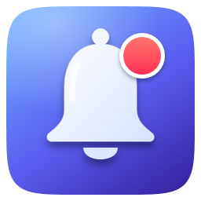

<p align="center"></p>

<h1 align="center">GlassBell</h1>

<p align="center">Уведомления всех приложений в виде быстрых стеклянных баннеров в стиле macOS. Для Windows 11.</p>

<p align="center"><a href="README.md">English</a> · <b>Русский</b></p>

---

GlassBell работает в фоне, ловит каждое уведомление Windows и показывает его стеклянным баннером в правом верхнем углу экрана. У баннера есть линза, которая изгибает фон у краёв, цветная кайма, блики по контуру и мягкая тень, подстраивающаяся под то, что за ней.

## Возможности

- **Все приложения.** GlassBell читает уведомления всех приложений через системный механизм Windows и показывает их своими баннерами. На экране может быть до четырёх баннеров стопкой.
- **Настоящее стекло, которое рисует видеокарта.** Преломление у краёв, дисперсия, блики, адаптивный цвет и тень. Четыре уровня качества. Есть «живой фон»: стекло следит за тем, что под ним, даже пока баннер едет.
- **С частотой экрана.** Видеокарта сама берёт изображение экрана за баннерами и рисует их целиком, поэтому стекло успевает за монитором на 60, 144, 240 Гц и выше, а процессор почти не занят. Классическая отрисовка из версии 1.0 осталась в настройках и включается сама, если видеокарта так не умеет.
- **Закрыть один или все.** Круглый × над углом баннера под указателем закрывает его, а если баннеров два и больше, под ними появляется кнопка **«Закрыть все»**. То же есть в меню трея и в командной строке (`--close-all`).
- **Быстро.** Одиночный баннер появляется через 30–60 мс после уведомления (замер на ПК разработчика).
- **Клик открывает источник**: то же, что открыл бы клик по родному уведомлению Windows.
- **Звук.** Три мелодии, синтезированные в коде, без аудиофайлов. Громкость может подстраиваться под громкость системы.
- **Настройки с живым предпросмотром**, значок в трее, автозапуск вместе с Windows.
- **20 языков.** Интерфейс берёт язык Windows (если такого языка нет, включается английский), а внизу настроек язык можно выбрать вручную.
- **Лёгкий.** В простое почти ничего не тратит, пока на экране баннеры — несколько процентов одного ядра; около 100 МБ памяти, в том числе после сотен баннеров (замер на ПК разработчика).

## Установка

1. Скачайте **GlassBell-Setup.exe** из [Releases](https://github.com/vibegineer/GlassBell/releases/latest) и запустите. Права администратора не нужны.
   Установщик не подписан цифровой подписью, поэтому SmartScreen может показать окно «Система Windows защитила ваш компьютер». Нажмите **Подробнее → Выполнить в любом случае**.
2. Включите режим **«Не беспокоить»** (Параметры → Система → Уведомления), чтобы рядом с баннерами GlassBell не появлялись баннеры Windows. В этом режиме уведомления всё равно приходят, и GlassBell их видит.

Значок рядом с часами открывает настройки. Удалить программу можно так: Параметры → Приложения → Установленные приложения → GlassBell → Удалить.

**Требования:** Windows 11, 64-бит. Всё остальное (.NET Framework 4.8, Direct3D 11) входит в Windows.

## Командная строка

GlassBell умеет показывать баннеры и для ваших скриптов:

```
GlassBell.exe --title "Сборка готова" --body "Все 214 тестов прошли" --app "CI"
```

| Команда | Что делает |
|---|---|
| `GlassBell.exe` | запускает GlassBell, если он не запущен, и открывает настройки |
| `--title T --body B [--app A] [--app-id AUMID] [--seconds S]` | показывает баннер (`--app-id` берёт значок установленного приложения) |
| `--test` | показывает два пробных баннера |
| `--close-all` | закрывает все баннеры на экране |
| `--settings` / `--quit` | открывает настройки / закрывает GlassBell |
| `--install` / `--uninstall` | включает / выключает автозапуск (для копии без установщика) |
| `--stats` | записывает в лог, сколько памяти занимает запущенная копия |

## Файлы

| Что | Где |
|---|---|
| Программа | `%LOCALAPPDATA%\Programs\GlassBell` |
| Настройки | `%APPDATA%\GlassBell\settings.ini` |
| Лог | `%LOCALAPPDATA%\GlassBell\log.txt` |

Язык, выбранный в настройках, хранится в `settings.ini` как `lang=ru` (или другой код из папки `lang/`); `lang=auto` возвращает язык Windows.
Если положить файл `portable.flag` рядом с `GlassBell.exe`, настройки и лог будут храниться в папке программы.

## Сборка

```
powershell -ExecutionPolicy Bypass -File build.ps1
```

Скрипт собирает `bin\GlassBell.exe` и `dist\GlassBell-Setup.exe` компилятором C# из .NET Framework, который входит в Windows. SDK, NuGet и Visual Studio не нужны.

| Папка | Что внутри |
|---|---|
| `src/` | программа: баннеры, отрисовка на видеокарте (`GpuEngine.cs`, `Dx.cs`), классическая отрисовка стекла, перехват уведомлений, настройки, звук |
| `setup/` | установщик и удаление |
| `lang/` | тексты интерфейса, по файлу на язык |
| `assets/` | значок |
| `tools/` | скрипты тестов и замеров, которыми пользовались при разработке, и генератор значка |

## Переводы

Переводы сделаны с помощью ИИ. Проверено только, что все строки на месте и помещаются; носители языков их не вычитывали. Исправления приветствуются: каждый язык — один текстовый файл в [`lang/`](lang), а в [`lang/en.txt`](lang/en.txt) объяснена каждая строка.

## Поддержать проект

GlassBell бесплатен. Если он вам пригодился, поддержать разработку можно на [Patreon](https://www.patreon.com/vibegineer).

## Лицензия

[MIT](LICENSE). macOS — товарный знак Apple Inc.; GlassBell не связан с Apple.
